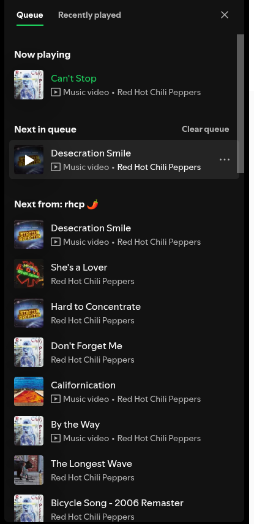

# Spicetify: Shuffle Next in Queue 🔀

[](https://spicetify.app/)
[](LICENSE)

A [Spicetify](https://spicetify.app/) extension that shuffles **only the user-enqueued tracks** (*"Next in queue"*), keeping your currently playing song and background playlist context completely untouched.



---

## 💡 Why This Extension?

In official Spotify, there are two separate playback streams:
1. **Context Tracks (`Next from: <playlist/album>`)**: The background album or playlist stream. Spotify's built-in shuffle button *only* randomizes this context.
2. **User Queue (`Next in queue`)**: Songs manually added via *"Add to queue"*. Spotify enforces a strict FIFO (First-In, First-Out) order on these tracks and **never** shuffles them.

If you manually queue up 10–20 songs for an upcoming session and want them in a random order, Spotify gives you no option. **Shuffle Next in Queue** solves this directly!

---

## ✨ Features

- **Non-Destructive**: Shuffles *only* the manual queue. Does not restart, skip, or interrupt the currently playing track, and does not alter background playlist tracks.
- **True Randomness**: Implements the classic [Fisher–Yates shuffle](https://en.wikipedia.org/wiki/Fisher%E2%80%93Yates_shuffle) algorithm for zero bias.
- **3 Fast Ways to Trigger**:
  1. **In-Queue Button**: Injected automatically right next to Spotify's native *"Clear queue"* button.
  2. **Topbar Button**: Quick-access shuffle icon on the top navigation bar.
  3. **Global Shortcuts**: Press <kbd>Ctrl</kbd> + <kbd>Alt</kbd> + <kbd>Q</kbd> or <kbd>Ctrl</kbd> + <kbd>Shift</kbd> + <kbd>S</kbd>.
- **Internationalization (i18n)**: Automatically detects Spotify's language with built-in translations for English, Portuguese, and Spanish.

---

## 📦 Installation

### Option 1: Via Spicetify Marketplace (Recommended)
1. Open Spotify with **Spicetify Marketplace** installed.
2. Go to the **Marketplace** tab in the sidebar.
3. Switch to the **Extensions** tab and search for `Shuffle Next in Queue`.
4. Click **Install** and reload Spotify.

---

### Option 2: Manual Installation via CLI

1. Download or copy `shuffle-queue.js` into your Spicetify Extensions folder:
   - **Linux / macOS**: `~/.config/spicetify/Extensions/`
   - **Windows**: `%appdata%\spicetify\Extensions\`

2. Enable the extension via Spicetify CLI:
   ```bash
   spicetify config extensions shuffle-queue.js
   spicetify apply
   ```

---

## ⌨️ Shortcuts

| Shortcut | Action |
| :--- | :--- |
| <kbd>Ctrl</kbd> + <kbd>Alt</kbd> + <kbd>Q</kbd> | Randomize user queue (*Next in queue*) |
| <kbd>Ctrl</kbd> + <kbd>Shift</kbd> + <kbd>S</kbd> | Alternative shortcut to randomize user queue |

---

## 📄 License

This project is licensed under the [MIT License](LICENSE).
